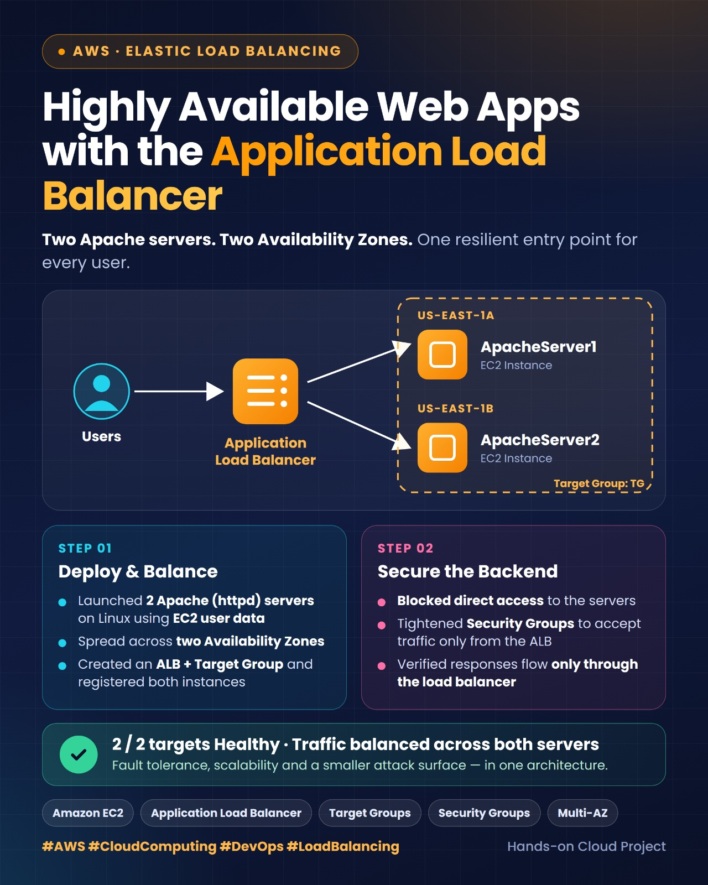
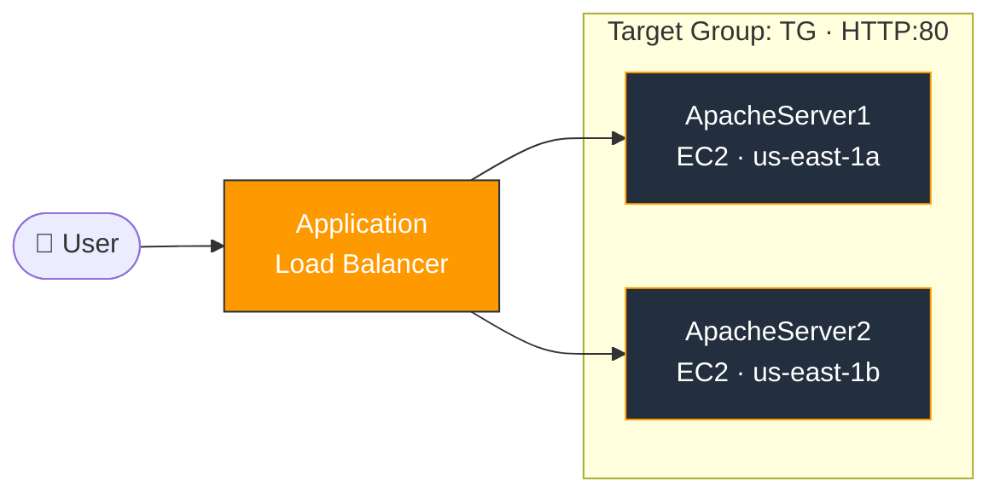
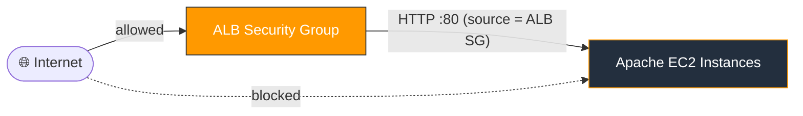

<div align="center">

# ⚖️ Highly Available Web Tier with AWS Application Load Balancer

**Two Apache servers · Two Availability Zones · One resilient entry point**


<br>



</div>

---

## 📌 Overview

This hands-on project demonstrates how to build a **fault-tolerant, load-balanced web tier on AWS**. Two Apache web servers run on EC2 instances in **different Availability Zones** and sit behind an **Application Load Balancer (ALB)**. The servers are then locked down with **Security Groups** so they can be reached **only through the ALB**, never directly from the internet.

### 🎯 Objectives

| | Task | Goal |
|---|------|------|
| **A** | Deploy & Balance | Launch 2 Apache servers via user data, create an ALB, register both servers and verify traffic is balanced |
| **B** | Secure the Backend | Block direct access to the servers and verify they respond only through the ALB |

---

## 🏗️ Architecture



---

## 🧰 Tech Stack

- **Amazon EC2**: Linux virtual servers
- **Apache HTTP Server (httpd)**: web server, installed through EC2 user data
- **Elastic Load Balancing (ALB)**: Layer 7 traffic distribution
- **Target Groups**: health checks and instance registration
- **Security Groups**: virtual firewalls for network access control

---

## 🚀 Implementation

### Task A: Deploy & Balance

#### 1️⃣ Launch two Apache servers with user data

Two EC2 instances were created in **us-east-1a** and **us-east-1b**. Each runs a bootstrap script that installs Apache and serves a unique page, so it is easy to see which server answered.

**ApacheServer1**

```bash
#!/bin/bash
yum update -y
yum install -y httpd.x86_64
systemctl start httpd.service
systemctl enable httpd.service
echo "Hello From ApacheServer1" > /var/www/html/index.html
```

**ApacheServer2**

```bash
#!/bin/bash
yum update -y
yum install -y httpd.x86_64
systemctl start httpd.service
systemctl enable httpd.service
echo "Hello From ApacheServer2" > /var/www/html/index.html
```

#### 2️⃣ Create the Target Group

| Setting | Value |
|---------|-------|
| Name | `TG` |
| Target type | Instance |
| Protocol : Port | HTTP : 80 |
| Registered targets | ApacheServer1, ApacheServer2 |

#### 3️⃣ Create the Application Load Balancer

- Scheme: internet-facing
- Subnets: one in **each** Availability Zone (us-east-1a and us-east-1b)
- Listener: HTTP : 80, forwarding to target group `TG`
- Dedicated Security Group named `ALB`

#### 4️⃣ Verify load balancing

Open the ALB DNS name in a browser and refresh repeatedly. The response alternates between:

```
Hello From ApacheServer1
Hello From ApacheServer2
```

The target group reports **2 / 2 targets Healthy**.

---

### Task B: Secure the Backend

By default the web servers accepted HTTP traffic from anywhere. To enforce a single, controlled entry point:

1. Edit the **inbound rules** of the EC2 instances' Security Group.
2. Change the HTTP (port 80) source from `0.0.0.0/0` to the **Security Group ID of the ALB**.
3. Keep only the access that is strictly required, such as SSH for administration.

**Result:** the servers respond only to traffic that comes through the ALB. Direct requests to the instances' public IPs are blocked.



---

## ✅ Results

- ✔️ Both Apache servers deployed automatically through user data
- ✔️ Traffic is evenly distributed across two Availability Zones
- ✔️ Target group health checks show **2 healthy targets**
- ✔️ Servers are **not reachable directly**, only through the ALB

---

## 💡 Key Learnings

- **High availability:** spreading instances across AZs removes a single point of failure.
- **Layer 7 load balancing:** an ALB routes HTTP traffic and monitors target health.
- **Defense in depth:** referencing a Security Group as a rule source is more secure and more maintainable than opening ports to the world.
- **Automation:** EC2 user data makes server setup repeatable with no manual steps.

---

## 📁 Repository Structure

```
aws-alb-multi-az-apache/
├── ALB.jpeg                          # Project overview graphic
├── Application Load Balancer.pdf     # Full step-by-step documentation with screenshots
└── README.md
```

## 👩‍💻 Author

**Iman Naseer**
[](https://github.com/Iman-Naseer)

---

<div align="center">

⭐ If you found this project helpful, consider giving it a star!

</div>
